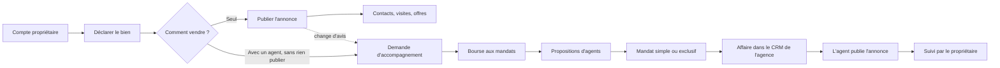
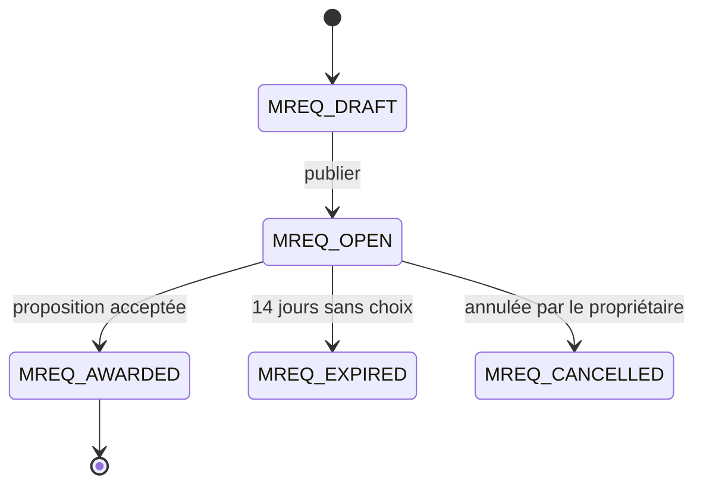
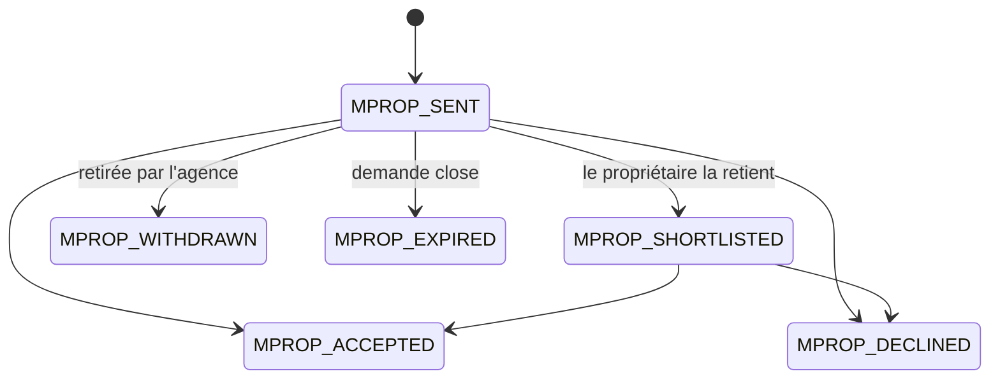
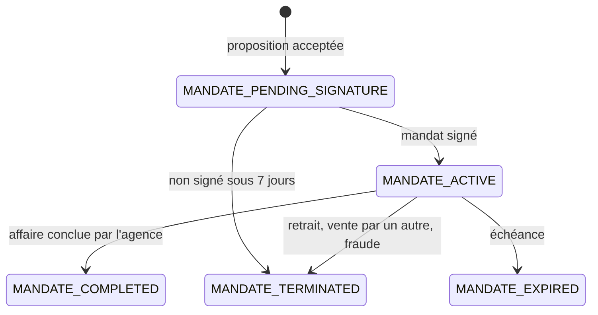

# Cas d'usage n°1 — Le propriétaire publie seul ou confie son bien à un agent

> **Statut**: Lots A et B livrés (UC-P1 à UC-P7) ; lot C TO-BE  
> **Dernière vérification**: 2026-11-25  
> **Source of truth**: Oui (espace propriétaire, bourse aux mandats, mandat)  
> **Dépendances**:  
- `docs/adr/0005-proprietaire-organisation-personnelle-et-mandat.md` (choix de modèle)  
- `docs/atlas-immobilier/02_fonctionnel/00_nomenclature_codes.md` (§ 10 bis, codes de ce cas d'usage)  
- `docs/atlas-immobilier/02_fonctionnel/02_regles_metier.md` (§ 8, règles « propriétaire et mandat »)  
- `docs/atlas-immobilier/02_fonctionnel/06_portail_annonces_mvp.md` (portail public)  
- `docs/atlas-immobilier/02_fonctionnel/10_ui_pro_listings_publication.md` (règles de publication)  
- `docs/atlas-immobilier/03_technique/10_rbac_permissions.md` (rôle `OWNER`, droits de la bourse)  
- `docs/atlas-immobilier/02_fonctionnel/05_feature_flags_plans.md` (module `module.mandate_marketplace`)

## 1. En bref

Un propriétaire veut vendre ou louer son bien sans passer à l'agence. Sur Atlas, il peut :

1. **publier lui-même** son annonce et traiter les contacts des acheteurs ou locataires ;
2. **dire aux agents ce qu'il attend** (prix, délai, services, commission) ;
3. **recevoir des propositions** d'agents, les comparer, échanger avec eux ;
4. **confier l'affaire** à l'agent choisi par un mandat, simple ou exclusif ;
5. **suivre son bien** depuis son espace, que l'affaire soit déléguée ou non.

Le propriétaire qui ne veut pas « se casser la tête » n'a pas besoin de publier : il décrit son bien, échange avec des agents **avant toute annonce publique**, et c'est l'agent mandaté qui publie. Le bien n'apparaît sur le portail qu'une fois le mandat signé.

De leur côté, les agents consultent une **bourse aux mandats** : les propriétaires de leur zone qui cherchent un agent. La plateforme rapproche les deux (matching) pour que chaque demande reçoive vite quelques propositions pertinentes.

| Acteur | Ce qu'il gagne |
|---|---|
| Propriétaire | Publier sans intermédiaire, ou choisir son agent sur des critères visibles, sans se déplacer ; garder la main sur son bien |
| Agent, agence | Des mandats entrants qualifiés dans sa zone, sans prospection à froid ; l'affaire arrive directement dans son CRM |
| Plateforme | Du stock d'annonces, de l'usage côté particuliers, un service vendable aux agences (bourse aux mandats) |

## 2. Acteurs

| Acteur | Compte | Description |
|---|---|---|
| **Propriétaire** (vendeur ou bailleur) | Nouveau rôle `OWNER`, organisation personnelle | Particulier qui possède le bien. Un seul compte peut gérer plusieurs biens |
| **Prospect** (acheteur ou locataire) | Aucun (portail public) | Contacte l'annonceur depuis le portail |
| **Agent** | `AGENT` ou `MANAGER` d'une agence | Consulte la bourse, propose ses services, traite le mandat dans son CRM |
| **Manager / admin d'agence** | `MANAGER`, `ADMIN` | Règle le profil public et les zones de l'agence, suit les propositions de l'équipe |
| **Agent indépendant** | Agence d'une personne (`ADMIN` de sa propre agence) | Même parcours qu'une agence (voir Q4) |
| **Modérateur plateforme** | `SUPER_ADMIN` (plus tard `MODERATOR`) | Valide les premières annonces des particuliers, traite fraudes et litiges |

## 3. Périmètre

**Dans le cas d'usage**
- Compte propriétaire, déclaration du bien, publication par le propriétaire.
- Contacts des prospects vers le propriétaire, visites, échanges.
- Demande d'accompagnement (« je cherche un agent »), bourse aux mandats, propositions, messagerie avant mandat.
- Mandat simple ou exclusif, création automatique de l'affaire dans le CRM de l'agence, suivi par le propriétaire.
- Matching : agents ↔ demande, acquéreurs de l'agence ↔ bien.

**Hors périmètre (pour l'instant)**
- Paiement en ligne de la commission ou des frais de service.
- Gestion locative après signature du bail (module distinct).
- Rédaction de compromis ou d'actes : la plateforme trace, le notaire ou l'adoul rédige.
- Procurations : la plateforme n'en établit pas (voir § 8).

## 4. Parcours

Les codes `UC-Px` servent de référence dans le backlog et les tests.

### UC-P1 — Créer son compte propriétaire

1. Depuis le portail (« Publier mon bien », `/proprietaire/inscription`), le visiteur saisit son téléphone.
2. Il reçoit un code à usage unique à 6 chiffres (WhatsApp, à défaut SMS), valable 10 minutes, 5 essais au plus. Il le saisit avec son nom, un mot de passe (8 caractères minimum) et, s'il le souhaite, son e-mail. Le téléphone est alors **vérifié**.
3. Il accepte les conditions d'utilisation et la politique de confidentialité (version et date tracées sur l'organisation, événement d'audit).
4. La plateforme crée son compte Keycloak (rôle `OWNER`) et son **organisation personnelle** (`org_type = OWNER`, identifiant `OWN-…`).
5. Il se connecte ensuite avec son numéro de téléphone (identifiant Keycloak = numéro au format international sans « + ») et son mot de passe.

Limites d'envoi : 3 codes par numéro par quart d'heure, 10 par adresse IP par heure.

Règles : un téléphone = un compte propriétaire. L'e-mail est facultatif. Un agent d'agence qui possède un bien utilise un compte propriétaire distinct (pas de mélange des rôles dans un même jeton).

### UC-P2 — Déclarer un bien

Le propriétaire décrit son bien une fois : type, transaction voulue (vente, location), ville, quartier, adresse précise, surface, pièces, caractéristiques, photos, prix souhaité.

- L'adresse précise et le numéro de titre foncier (facultatif) restent **privés** : jamais affichés sur le portail, transmis à une agence seulement après mandat.
- Le bien existe indépendamment de toute annonce : c'est lui que les annonces (du propriétaire ou des agences) diffusent.
- Un bien peut rester **privé** : sans annonce, rien n'est visible sur le portail. C'est le cas du propriétaire qui délègue d'emblée (UC-P5).

### UC-P3 — Publier soi-même

1. Le propriétaire crée l'annonce depuis la fiche du bien. Les règles de publication des agences s'appliquent : 3 photos minimum, score de qualité, contrôle doublon et fraude.
2. **La première annonce d'un nouveau propriétaire passe en modération** avant d'être visible (R-PROP-04). Les suivantes sont publiées directement si le score de fraude est bas.
3. Sur le portail, l'annonce porte le badge « Particulier ». Le numéro du propriétaire n'est pas affiché, sauf s'il l'a choisi.

### UC-P4 — Recevoir les contacts et organiser les visites

1. Un prospect remplit le formulaire de contact de l'annonce, avec son consentement. Le lead arrive dans l'**espace propriétaire** (organisation du propriétaire, comme pour une agence aujourd'hui).
2. Le propriétaire est prévenu (WhatsApp ou e-mail). Il voit le nom, le message et le téléphone du prospect, qui a accepté d'être recontacté par l'annonceur.
3. Il répond par la messagerie de la plateforme, ou appelle le prospect. Il peut proposer des créneaux de visite ; le prospect confirme par lien.
4. Statuts simplifiés pour le propriétaire : Nouveau, En contact, Visite prévue, Conclu, Sans suite. Ils correspondent aux codes `CRM_*` du lead (§ 9). Le propriétaire ne voit que les changements permis par le workflow du lead qui ne demandent aucune saisie.

> **Livré (lot A).**
> - Alerte au propriétaire à chaque nouveau contact.
> - Fil d'échanges dans la plateforme (`/proprietaire/contacts/{id}`) ; la première réponse fait passer le contact « En contact ».
> - Le prospect, sans compte, suit l'échange par un lien personnel (`/contact/{jeton}`, valable 60 jours, jeton stocké haché, envoyé à l'API dans l'en-tête `X-Conversation-Token`) : il lit, répond (20 messages par heure au plus) et choisit un créneau.
> - Créneaux : 1 à 3 par envoi, entre 30 minutes et 60 jours à l'avance, 4 heures au plus ; un nouvel envoi remplace les créneaux en attente. Le créneau choisi crée le rendez-vous et fait passer le contact « Visite prévue » si le workflow le permet. Le propriétaire peut annuler la visite.
> - Alertes : WhatsApp (modèle « utilitaire » de la plateforme), sinon e-mail, sinon SMS ; au prospect seulement sur les canaux où son accord « recontact » est en vigueur. Pas de nouvelle alerte de message tant que la précédente n'a pas été lue (30 minutes au plus), sauf créneaux, visite choisie ou annulée.
> - L'adresse précise et le téléphone du propriétaire ne sont jamais montrés au prospect.
>
> **Restent à faire** : rappel de visite (les rappels automatiques sont coupés pour ces rendez-vous), « proposer d'autres créneaux » côté prospect.

### UC-P5 — Dire aux agents ce qu'on attend (demande d'accompagnement)

C'est le parcours du propriétaire qui ne veut pas gérer la vente lui-même. Il n'a **pas besoin de publier** : la demande se fait sur un bien privé, et l'annonce publique viendra de l'agent mandaté. Deux façons de la lancer :

- **Demande ouverte** : elle va dans la bourse aux mandats et toutes les agences de la zone peuvent proposer (UC-P6).
- **Demande directe** : depuis l'annuaire ou le profil d'un agent, le propriétaire choisit « Confier mon bien à cet agent ». Seule cette agence voit la demande ; elle n'apparaît pas dans la bourse. Si l'agence ne répond pas sous 72 h ou décline, le propriétaire peut la transformer en demande ouverte.

Dans les deux cas, le propriétaire et l'agent échangent par la messagerie de la plateforme avant tout mandat (UC-P7).

Contenu de la **demande d'accompagnement** :

| Champ | Exemple |
|---|---|
| Objectif | Vendre, louer |
| Prix souhaité | 1 450 000 MAD (ou loyer) |
| Délai | Sous 3 mois |
| Type de mandat accepté | Simple, exclusif, ou les deux |
| Services attendus | Estimation, photos pro, visites, négociation, suivi juridique, sélection du locataire |
| Commission envisagée | Facultatif : % ou forfait, à la charge de qui |
| Disponibilités, langue | Soirs et week-end ; français, arabe |
| Message libre | « Bien hérité, je vis à l'étranger » |

- La demande est **ouverte 14 jours** et accepte **5 propositions au plus** (réglable par la plateforme). Au-delà, elle se ferme aux nouvelles propositions.
- Si le bien a déjà une annonce du propriétaire, elle reste en ligne pendant la demande. S'il n'en a pas, il reste privé.
- Une demande directe vise une seule agence et ne compte pas dans le plafond de 5 propositions.

### UC-P6 — Les agents trouvent les propriétaires (bourse aux mandats)

1. Dans l'espace Pro, l'écran **Bourse aux mandats** liste les demandes ouvertes des zones de l'agence, triées par score de matching (§ 5.1).
2. La fiche d'une demande est **anonymisée** : quartier sans adresse, prénom et initiale, pas de téléphone. Elle affiche ce que la plateforme sait de l'agence : « 12 acquéreurs compatibles dans votre CRM » (§ 5.2).
3. L'agent envoie une **proposition** : type de mandat, durée, commission, services inclus, estimation (fourchette) et message. Il peut joindre des références.
4. Les meilleures agences reçoivent une notification à l'ouverture de la demande ; les autres la trouvent dans la bourse. Le propriétaire peut aussi **inviter** un agent recommandé.

Garde-fous :
- seules les agences **vérifiées** (`verifiedPro`) avec le module actif proposent ;
- une agence envoie une seule proposition par demande ;
- quota mensuel de propositions par agence, selon le plan (R-PROP-11) ;
- les agences ne voient pas les propositions concurrentes.

### UC-P7 — Comparer, échanger et confier le mandat

1. Le propriétaire voit les propositions côte à côte : agence, note et historique sur la plateforme, commission, type et durée de mandat, services, estimation.
2. Il peut échanger avec chaque agent dans un fil de messagerie. **Avant acceptation, les numéros et e-mails écrits dans les messages sont masqués** (R-PROP-08).
3. Il accepte une proposition (exclusif) ou plusieurs (simple). L'acceptation est confirmée par un code à usage unique (preuve du consentement).
4. La plateforme crée le **mandat** (`MANDATE_PENDING_SIGNATURE`) et génère le document de mandat à partir du modèle. Signature en ligne si le module signature est actif, sinon signature papier déclarée par l'agence.
5. Dès l'acceptation, l'agence reçoit les coordonnées du propriétaire et l'adresse du bien. Un **dossier `CRM_MANDATE_SALE` ou `CRM_MANDATE_RENT`** est créé dans son CRM, avec le propriétaire en partie prenante `OWNER`.
6. Les autres propositions passent en « Non retenue » ; leurs agents sont prévenus.

> **Livré (lot B).**
> - Côté propriétaire : bouton « Demander des propositions » sur la fiche du bien, demande ouverte à la bourse ou directe (annuaire des agences vérifiées de la ville), page `/proprietaire/demandes/{id}` qui compare les propositions, fil d'échanges par proposition, acceptation en deux temps (consentement explicite au partage, puis code envoyé par WhatsApp ou SMS, objet `MANDATE_ACCEPT`).
> - Côté agence : `/pro/mandats` (onglets Bourse, Demandes directes, Mes propositions, Mandats), fiche anonymisée et formulaire de proposition, « Je ne peux pas » pour une demande directe, mandat obtenu avec coordonnées et adresse, « Déclarer le mandat signé », « Créer l'annonce du bien » (brouillon lié au bien et au mandat, quartier affiché, jamais l'adresse). Profil public et zones : `/pro/mandats/profil` (manager ou administrateur).
> - Plateforme : vérification d'une agence par le super-admin (`/pro/moderation`, `PUT /api/v1/admin/agencies/{orgId}/verification`) ; seule une agence vérifiée accède à la bourse et figure dans l'annuaire ; module `module.mandate_marketplace`.
> - Mandat simple : après un premier mandat, les autres propositions simples restent acceptables, les exclusives sont écartées. Mandat exclusif : toutes les autres sont écartées.
> - Dossier `CRM_MANDATE_SALE`/`CRM_MANDATE_RENT` créé dans l'agence, statut `CRM_MANDATE_PENDING`, assigné à l'agent auteur de la proposition, propriétaire en partie prenante `OWNER`. « Mandat signé » sur le dossier (bouton ou écran Pro) rend le mandat actif ; la publication de l'annonce de l'agence fait passer le dossier `CRM_LISTED`.
> - Échéances (tâche horaire) : demande ouverte 14 jours ; mandat non signé sous 7 jours résilié (`NOT_SIGNED`) ; mandat actif échu (`TERM_REACHED`).
> - Alertes : propriétaire par WhatsApp (modèle `<site>/p/{{1}}`, `d<id>` pour une demande) à chaque proposition, message d'agence, refus d'une demande directe, signature ; agent par notification in-app (message, décision, mandat).
>
> **Restent à faire** : génération du document de mandat depuis un modèle validé par un juriste et signature en ligne ; notification des agences de la zone à l'ouverture d'une demande (lot C, avec le score § 5.1) ; notification in-app d'une demande directe (aucun destinataire désigné aujourd'hui : l'onglet « Demandes directes » la signale).

### UC-P8 — Suivre son bien délégué

Le propriétaire garde la main depuis son espace :
- statut du mandat et dates ;
- annonce(s) publiée(s) par l'agence, vues et contacts reçus (nombres) ;
- visites réalisées et retours, offres reçues : ce sont les événements que l'agent marque « visibles par le propriétaire » dans le dossier ;
- messagerie avec l'agent ;
- décision sur une offre (accepter, refuser, contre-proposer), tracée dans le dossier de l'agence.

Si le bien était privé, l'annonce de l'agence est la première publication : elle passe par les règles de publication de l'agence, sans modération a priori par la plateforme.

En mandat **exclusif**, l'annonce du propriétaire est suspendue (`SUSPENDED`, motif mandat exclusif) et son URL redirige vers l'annonce de l'agence. En mandat **simple**, les annonces coexistent et le portail les regroupe sur le même bien (R-PROP-06).

### UC-P9 — Fin du mandat

Un mandat se termine par : affaire conclue par l'agence, vente par le propriétaire ou un tiers, échéance, retrait d'une partie, fraude. Le motif est obligatoire (`MANDATE_END_REASON`). Le propriétaire peut ensuite noter l'agence (avis vérifié, rattaché à un mandat réel) et rouvrir une demande.

## 5. Matching

Trois rapprochements, du plus simple au plus délicat.

### 5.1 Agents ↔ demande d'accompagnement

**Filtres stricts** : agence vérifiée, module actif, quota restant, zone d'intervention qui couvre la ville (ou le quartier), transaction et type de bien couverts.

**Score sur 100** (affiché à l'agent comme « pertinence », jamais le détail) :

| Critère | Poids | Source |
|---|---|---|
| Zone : quartier couvert (sinon ville seule) | 35 | Zones de l'agence |
| Spécialité : type de bien et transaction | 20 | Profil de l'agence |
| Historique dans la zone : mandats et ventes conclues sur la plateforme | 15 | Dossiers `CRM_MANDATE_*` clos gagnés |
| Réactivité : délai médian de réponse aux demandes et messages | 10 | Horodatage des propositions et messages |
| Avis des propriétaires | 10 | Avis vérifiés (UC-P9) |
| Acquéreurs compatibles dans son CRM | 10 | § 5.2, nombre ramené à une échelle |

Usage : top 5 affiché au propriétaire (« Agents recommandés », avec bouton Inviter) ; notification aux 10 meilleures agences à l'ouverture de la demande ; tri de la bourse.

Une agence nouvelle sur la plateforme n'a ni historique ni avis : pour ne pas l'exclure, ces deux critères prennent une valeur neutre (la moitié du poids) pendant ses 3 premiers mois.

### 5.2 Acquéreurs de l'agence ↔ bien

Quand un agent consulte une demande, la plateforme compte les dossiers acheteurs ou locataires **de sa propre agence** dont les critères correspondent au bien (même moteur que `ReverseMatchingService`). Le calcul reste dans l'organisation de l'agence : aucune donnée ne circule entre agences. C'est un argument concret pour la proposition (« j'ai déjà 12 acquéreurs pour ce type de bien »).

### 5.3 Bien du propriétaire ↔ prospects du portail

Pour une annonce publiée par le propriétaire : rapprochement avec les alertes de recherche des visiteurs du portail, quand elles existeront. Pas de rapprochement avec les acheteurs des agences : ce sont leurs données.

Une statistique agrégée inter-agences (« 40 acquéreurs actifs pour ce type de bien dans la zone ») serait un fort argument pour déléguer, mais elle exploite les données des agences : elle demande leur accord explicite. Question ouverte Q7.

## 6. Règles métier

| Code | Règle |
|---|---|
| R-PROP-01 | Un téléphone vérifié par code à usage unique est obligatoire pour publier, ouvrir une demande ou accepter une proposition |
| R-PROP-02 | L'adresse précise, le titre foncier et les coordonnées du propriétaire ne sont jamais publics ; une agence les obtient seulement à l'acceptation de sa proposition |
| R-PROP-03 | Un bien appartient à une seule organisation propriétaire ; ses annonces, qu'elles viennent du propriétaire ou d'agences, portent son `property_id` |
| R-PROP-04 | La première annonce d'un propriétaire passe en modération a priori ; les suivantes aussi si le score de fraude dépasse le seuil |
| R-PROP-05 | Mandat exclusif : un seul mandat actif sur le bien ; l'annonce du propriétaire est suspendue tant qu'il dure ; aucune nouvelle demande d'accompagnement possible |
| R-PROP-06 | Mandat simple : plusieurs mandats actifs possibles ; le portail affiche une seule fiche par bien avec la liste des annonceurs ; le contrôle doublon ignore les annonces d'un même `property_id` |
| R-PROP-07 | Une demande accepte au plus 5 propositions et reste ouverte 14 jours ; une agence ne propose qu'une fois par demande et peut retirer sa proposition tant qu'elle n'est pas acceptée |
| R-PROP-08 | Avant acceptation, la messagerie masque les numéros de téléphone, e-mails et liens WhatsApp écrits dans les messages |
| R-PROP-09 | L'acceptation d'une proposition est confirmée par code à usage unique et tracée (audit + consentement au partage des coordonnées avec cette agence) |
| R-PROP-10 | La durée d'un mandat est fixée dans la proposition (1 à 12 mois) ; à échéance, il expire sauf renouvellement accepté par les deux parties |
| R-PROP-11 | Le nombre de propositions par agence et par mois dépend du plan (`quota.mandate_proposals_month`) ; une proposition retirée ne rend pas le crédit |
| R-PROP-12 | Seuls les événements du dossier marqués « visible propriétaire » apparaissent dans l'espace propriétaire ; notes internes et autres prospects restent privés |
| R-PROP-13 | Un avis sur une agence n'est possible qu'à la fin d'un mandat réel, une fois par mandat |
| R-PROP-14 | Le propriétaire peut supprimer son compte : annonces retirées, demandes annulées ; les mandats actifs doivent d'abord être terminés ; les dossiers des agences conservent ce qui a été transmis sous mandat |
| R-PROP-15 | Un bien sans annonce reste privé : ni le portail ni la bourse ne montrent son adresse ; seule l'annonce publiée par une agence mandatée le rend public |
| R-PROP-16 | Une demande directe n'est visible que par l'agence choisie ; sans réponse sous 72 h ou en cas de refus, le propriétaire peut l'ouvrir à la bourse |

## 7. Confiance et conformité

- **Identité** : téléphone vérifié (R-PROP-01). Vérification d'identité légère en V1 (CNIE contrôlée par un modérateur, pièce non conservée au-delà du contrôle) donnant le badge « Propriétaire vérifié ».
- **Propriété** : numéro de titre foncier ou attestation déclaré par le propriétaire, contrôle manuel, badge « Bien vérifié ». Facultatif, mais exigé pour lever une suspension pour fraude.
- **Agences** : seules les agences `verifiedPro` accèdent à la bourse. La profession d'agent immobilier n'a pas encore de statut légal au Maroc (projet de loi en attente depuis 2014) : la vérification est celle de la plateforme (RC, ICE, identité du gérant).
- **Données personnelles (loi 09-08)** : la plateforme collecte les données du propriétaire pour la mise en relation ; elles ne sont transmises à une agence qu'avec son accord explicite (R-PROP-09), qui devient alors responsable de leur traitement pour le mandat. La déclaration du traitement auprès de la CNDP est à mettre à jour.
- **Procurations (loi 31.18)** : depuis le 1er juin 2026, une procuration portant sur un droit réel doit être enregistrée. Le mandat de commercialisation n'est pas une procuration : il ne permet pas à l'agent de signer la vente. La spec ne prévoit aucune procuration ; l'écran du mandat le rappelle.
- **Modèle de mandat** : document généré depuis un modèle à faire valider par un juriste (type, durée, commission, débiteur de la commission, clause d'exclusivité, résiliation).

## 8. Modèle de données (cible)

Le choix est décrit dans l'ADR 0005. En résumé : **chaque propriétaire a son organisation**, ce qui réutilise annonces, leads, messages et RDV sans toucher à l'isolation. Les objets qui relient un propriétaire et une agence sont **inter-organisations** et portent les deux identifiants.

| Entité | Portée | Champs principaux |
|---|---|---|
| `organization` (nouvelle) | Plateforme | `org_id`, `org_type` (`AGENCY`, `OWNER`, `PLATFORM`), nom affiché, `verified` |
| `property` (nouvelle) | Organisation propriétaire | type, transaction, ville, quartier, adresse (privée), surface, pièces, caractéristiques, titre foncier (privé), `verification_status` |
| `annonce` (existante) | Organisation qui publie | + `property_id`, `publisher_kind` (`OWNER`, `AGENCY`), `mandate_id` |
| `mandate_request` (nouvelle) | Inter-orgs (côté propriétaire) | `owner_org_id`, `property_id`, `visibility` (`MREQ_OPEN_MARKET`, `MREQ_DIRECT`), `target_agency_org_id` (demande directe), objectif, prix, délai, types de mandat acceptés, services, commission envisagée, statut `MREQ_*`, `expires_at`, `max_proposals` |
| `mandate_proposal` (nouvelle) | Inter-orgs | `request_id`, `agency_org_id`, `agent_user_id`, type et durée de mandat, commission, payeur, services, estimation min/max, message, statut `MPROP_*` |
| `mandate` (nouvelle) | Inter-orgs | `owner_org_id`, `agency_org_id`, `property_id`, `proposal_id`, type, début, fin, commission, statut `MANDATE_*`, motif de fin, `dossier_id` (côté agence), document signé |
| `marketplace_thread` + `marketplace_message` (nouvelles) | Inter-orgs | fil propriétaire ↔ agence rattaché à une proposition ; contenu masqué avant acceptation |
| `agency_profile`, `agency_zone` (nouvelles) | Organisation agence | présentation, langues, spécialités ; zones (ville, quartiers) |
| `agency_review` (nouvelle) | Inter-orgs | `mandate_id`, note, commentaire, réponse de l'agence |

Les entités inter-organisations n'utilisent pas le filtre `orgIdFilter` ; un service unique (`MandateAccessService`) vérifie que l'utilisateur appartient à l'une des deux organisations et que le statut autorise la lecture demandée.

### Cycle de vie

## 9. Liens avec le CRM de l'agence

À l'acceptation, la plateforme crée dans l'organisation de l'agence un dossier :
- `case_type` : `CRM_MANDATE_SALE` ou `CRM_MANDATE_RENT` ;
- statut initial `CRM_MANDATE_PENDING`, puis `CRM_MANDATE_SIGNED` à la signature, `CRM_LISTED` à la publication de l'annonce de l'agence, puis le pipeline de transaction (`CRM_VISIT_*`, `CRM_OFFER_RECEIVED`, `CRM_NEGOTIATION`, `CRM_COMPROMISE_SIGNED`, `CRM_CLOSED_WON` / `CRM_CLOSED_LOST`) ;
- partie prenante `OWNER` = le propriétaire ; assigné à l'agent auteur de la proposition.

Ce workflow est à ajouter à `DossierWorkflowCatalog` (ADR 0004). Le passage du dossier en `CRM_CLOSED_WON` propose de clore le mandat en `MANDATE_COMPLETED`.

Les leads reçus directement par le propriétaire (UC-P4) sont des dossiers `CRM_LEAD_BUY` ou `CRM_LEAD_RENT` de son organisation. Correspondance des statuts affichés : Nouveau = `CRM_NEW` ; En contact = `CRM_QUALIFYING` ou `CRM_QUALIFIED` ; Visite prévue = `CRM_VISIT_PLANNED` ; Conclu = `CRM_CLOSED_WON` ; Sans suite = `CRM_CLOSED_LOST`.

## 10. Rôles et droits

| Action | Propriétaire | Agent | Manager | Admin agence | Modérateur |
|---|---|---|---|---|---|
| Gérer ses biens, annonces, leads | Oui (les siens) | — | — | — | Lecture |
| Ouvrir, annuler une demande d'accompagnement | Oui | — | — | — | Lecture |
| Consulter la bourse aux mandats | — | Oui | Oui | Oui | Oui |
| Envoyer, retirer une proposition | — | Oui | Oui | Oui | — |
| Voir les propositions de l'équipe | — | Les siennes | Toutes | Toutes | — |
| Accepter, refuser une proposition | Oui | — | — | — | — |
| Lire coordonnées et adresse du propriétaire | — | Mandat `PENDING_SIGNATURE` ou `ACTIVE` de son agence | Idem | Idem | Oui |
| Régler profil public et zones de l'agence | — | — | Oui | Oui | — |
| Valider une annonce de particulier, suspendre | — | — | — | — | Oui |

Nouveau rôle Keycloak `OWNER` : il donne `ROLE_OWNER` et **pas** `ROLE_PRO`. Les règles fines passent par `AccessPolicy`.

## 11. API (esquisse)

| Endpoint | Accès | Effet |
|---|---|---|
| `POST /api/public/v1/owner/signup` puis `/verify` | Public | Code à usage unique, création du compte et de l'organisation |
| `GET/POST/PUT /api/v1/owner/properties` | `OWNER` | Biens du propriétaire |
| `POST /api/v1/owner/properties/{id}/annonce` | `OWNER` | Crée ou met à jour l'annonce du propriétaire, soumise aux règles de publication |
| `GET /api/v1/owner/leads`, `PUT …/{id}/status` | `OWNER` | Contacts de son organisation, statut simplifié (livré) |
| `GET /api/v1/owner/leads/{id}/conversation`, `POST …/messages`, `POST/DELETE …/visit-proposals`, `POST …/visits/{vid}/cancel` | `OWNER` | Échanges avec le prospect, créneaux, annulation (livré) |
| `GET /api/v1/portal/conversation`, `POST …/messages`, `POST …/visit-proposals/{id}/accept` | Public, en-tête `X-Conversation-Token` | Côté prospect : lire, répondre, choisir un créneau (livré) |
| `POST /api/v1/owner/mandate-requests`, `PUT …/{id}/cancel`, `PUT …/{id}/open-to-market` | `OWNER` | Demandes d'accompagnement, ouvertes ou directes ; passage d'une demande directe à la bourse |
| `GET /api/v1/owner/mandate-requests/{id}/proposals`, `/recommended-agencies` | `OWNER` | Propositions reçues, agences recommandées (§ 5.1) |
| `POST /api/v1/owner/proposals/{id}/accept` (code à usage unique), `/decline`, `/shortlist` | `OWNER` | Décision ; l'acceptation crée mandat et dossier |
| `GET /api/v1/owner/mandates/{id}` | `OWNER` | Suivi du mandat et événements visibles |
| `GET /api/v1/marketplace/mandate-requests?city=&type=&transaction=` | Pro, agence vérifiée, module actif | Bourse anonymisée, triée par score |
| `GET /api/v1/marketplace/mandate-requests/{id}` | Idem | Fiche anonymisée + acquéreurs compatibles de l'agence (§ 5.2) |
| `POST /api/v1/marketplace/mandate-requests/{id}/proposals`, `DELETE …/proposals/{pid}` | Idem | Envoyer, retirer |
| `GET /api/v1/marketplace/proposals?mine=` | Idem | Propositions de l'agent ou de l'agence |
| `GET /api/v1/marketplace/direct-requests` | Idem | Demandes directes adressées à l'agence |
| `GET/POST /api/v1/marketplace/threads/{id}/messages` | Les deux parties | Messagerie, masquage avant acceptation |
| `GET/PUT /api/v1/agency/profile`, `/agency/zones` | Manager, admin | Profil public et zones |
| `GET /api/public/v1/agencies?city=`, `/agencies/{id}` | Public | Annuaire et profil public des agences |

## 12. Écrans

**Portail** : bouton « Publier mon bien » dans l'en-tête ; page « Trouver un agent » ; badge « Particulier » sur les annonces ; fiche unique par bien avec la liste des annonceurs (mandat simple) ; profil public d'agence.

**Espace propriétaire** (`/proprietaire`, même application Angular, design system Pro) :
- Accueil : mes biens, actions à faire (contacts non lus, propositions à examiner, visite demain) ;
- Fiche bien : annonce, statistiques, contacts, demande d'accompagnement, mandat ;
- Contacts et visites ;
- Trouver un agent : formulaire de demande (ouverte ou directe), annuaire et profils d'agents, agents recommandés, comparateur de propositions, fil de messages ;
- Mes mandats : statut, événements visibles, offres à décider.

**Espace Pro** :
- Bourse aux mandats (`/pro/mandats`) : liste filtrable, fiche anonymisée, proposition en boîte de dialogue ; onglet « Demandes directes » pour celles adressées à l'agence ;
- Mes propositions : suivi des statuts ;
- Réglages agence : profil public, zones, spécialités ;
- Les mandats obtenus arrivent dans « Mes dossiers » (filtre par type de dossier).

## 13. Notifications

| Événement | Destinataire | Canal |
|---|---|---|
| Nouveau contact sur l'annonce, message du prospect, visite choisie | Propriétaire | WhatsApp (modèle), SMS, espace (livré) |
| Réponse du propriétaire, créneaux proposés, visite annulée | Prospect | WhatsApp (modèle), e-mail, SMS, avec lien personnel (livré) |
| Demande ouverte correspondant à l'agence (top 10) | Agents de l'agence, selon zones | Espace Pro, e-mail |
| Invitation à proposer, demande directe | Agence visée | Espace Pro, e-mail, WhatsApp |
| Demande directe sans réponse à 48 h | Agence visée (rappel) ; à 72 h, le propriétaire | Espace, e-mail |
| Nouvelle proposition, nouveau message | Propriétaire | WhatsApp (modèle), espace |
| Proposition acceptée ou non retenue | Agent | Espace Pro, e-mail |
| Mandat à signer, signé, bientôt échu (J-15), terminé | Les deux | Espace, e-mail |
| Offre reçue sur le bien | Propriétaire | WhatsApp, espace |
| Demande sans proposition après 48 h | Propriétaire (et équipe plateforme) | Espace, e-mail |

Les messages WhatsApp sortants hors fenêtre de 24 h utilisent des modèles approuvés par Meta (règles § 2 de `02_regles_metier.md`).

## 14. Découpage en lots

| Lot | Contenu | Pré-requis |
|---|---|---|
| **A — Propriétaire autonome** | UC-P1 à UC-P4 : rôle `OWNER`, table `organization`, organisation personnelle, code à usage unique, `property`, annonce du propriétaire avec modération a priori, leads et visites dans l'espace propriétaire | Release de stabilisation en production |
| **B — Bourse aux mandats** | UC-P5 à UC-P7 : demande ouverte ou directe sur un bien privé ou publié, annuaire et profils d'agence, zones, bourse, propositions, messagerie masquée, acceptation, mandat, dossier `CRM_MANDATE_*`, annonce d'agence liée au bien, suspension en exclusif | Lot A ; workflow mandat dans `DossierWorkflowCatalog` |
| **C — Matching et suivi** | Score § 5.1, invitations, acquéreurs compatibles § 5.2, suivi UC-P8, fin de mandat et avis UC-P9, badges de vérification, quotas par plan | Lot B |

### Critères d'acceptation

**Lot A**
- PA-1 : un visiteur crée un compte propriétaire avec son téléphone et un code ; un second compte avec le même numéro est refusé.
- PA-2 : le propriétaire publie un bien avec 3 photos ; l'annonce attend la modération ; validée, elle apparaît sur le portail avec le badge « Particulier », sans adresse ni téléphone.
- PA-3 : un lead envoyé sur cette annonce arrive dans l'espace du propriétaire et dans aucune agence (test à deux agences + un propriétaire).
- PA-4 : un compte `OWNER` reçoit 403 sur toute route `/api/v1/` réservée au Pro ; un agent reçoit 403 sur `/api/v1/owner/**`.
- PA-5 : un nouveau contact alerte le propriétaire ; sa réponse alerte le prospect, qui la lit et répond par son lien sans compte ; le créneau choisi crée la visite, passe le contact « Visite prévue » et alerte le propriétaire ; un lien invalide ou un autre propriétaire reçoit 404.

**Lot B**
- PB-1 : une agence vérifiée de Tanger voit la demande d'un propriétaire de Tanger, anonymisée ; une agence de Rabat ne la voit pas ; une agence non vérifiée n'a pas accès à la bourse.
- PB-2 : la 6e proposition sur une demande est refusée ; une agence ne peut pas proposer deux fois.
- PB-3 : avant acceptation, un numéro écrit dans un message est masqué des deux côtés.
- PB-4 : l'acceptation avec code crée le mandat, le dossier `CRM_MANDATE_SALE` assigné à l'agent, et révèle les coordonnées à cette seule agence ; les autres propositions passent `MPROP_DECLINED`.
- PB-5 : en exclusif, l'annonce du propriétaire passe `SUSPENDED` et son URL redirige vers l'annonce de l'agence ; une nouvelle demande sur le bien est refusée.
- PB-6 : en simple, deux agences publient le même bien ; le portail montre une seule fiche avec deux annonceurs ; aucune alerte doublon entre elles.
- PB-7 : un propriétaire sans annonce envoie une demande directe à une agence ; elle n'apparaît ni sur le portail ni dans la bourse des autres agences ; après mandat, l'annonce publiée par l'agence est la première fiche publique du bien.
- PB-8 : une demande directe restée sans réponse 72 h peut être ouverte à la bourse ; l'agence visée garde son accès.

**Lot C**
- PC-1 : le propriétaire voit 5 agences recommandées classées par score ; une agence hors zone n'y figure jamais.
- PC-2 : la fiche d'une demande affiche le nombre d'acquéreurs compatibles calculé dans la seule agence qui consulte.
- PC-3 : un événement de dossier marqué « visible propriétaire » apparaît dans l'espace propriétaire ; une note interne n'apparaît pas.
- PC-4 : un avis n'est possible qu'après un mandat terminé, une fois.

## 15. Indicateurs

- Part des comptes propriétaires qui publient ou ouvrent une demande dans les 24 h.
- Délai jusqu'à la première proposition (cible : moins de 24 h) ; propositions par demande (cible : 3).
- Conversion demande → mandat signé ; mandat → affaire conclue.
- Part des demandes sans proposition (signal de couverture insuffisante d'une zone).
- Délai de modération des annonces de particuliers.

## 16. Risques

| Risque | Réponse |
|---|---|
| Pas assez d'agences dans une zone : demandes sans réponse | Ouvrir ville par ville (Tanger d'abord), alerte à 48 h, invitation manuelle par l'équipe |
| Faux propriétaires, annonces de biens d'autrui | Téléphone vérifié, modération a priori, badges, titre foncier exigé en cas de signalement |
| Spam des agences vers les propriétaires | Plafond de propositions, quota par plan, masquage des coordonnées avant acceptation, signalement d'une proposition |
| Contournement (contact direct hors plateforme) | Coordonnées seulement après acceptation ; la valeur (bourse, CRM, suivi) reste dans la plateforme |
| Fuite de données entre agences | Entités inter-orgs derrière un seul service d'accès ; tests d'isolation à deux agences et un propriétaire à chaque lot |
| Doublons d'annonces sur un même bien | `property_id` commun, fiche unique sur le portail (R-PROP-06) |
| Valeur juridique du mandat | Modèle validé par un juriste ; preuve d'acceptation par code ; signature électronique si le module est actif |

## 17. Décisions et questions ouvertes

Décidé le 2026-11-25 :

| # | Question | Décision |
|---|---|---|
| Q1 | « Un propriétaire peut entrer en communication avec … » | Propriétaire ↔ agent **avant toute publication** : le propriétaire qui ne veut pas gérer lui-même échange avec des agents sur un bien privé et mandate l'un d'eux, qui publie (UC-P5, demande ouverte ou directe). Pas de messagerie entre propriétaires |
| Q2 | Facturation de la bourse aux agences | Gratuite au lancement avec quota, puis quota inclus selon le plan |
| Q3 | Échanges prospect ↔ propriétaire | Messagerie de la plateforme + alerte WhatsApp ; numéro du propriétaire caché sauf s'il choisit de l'afficher |
| Q4 | Agents indépendants | Admis comme agence d'une personne, avec la même vérification |

Encore ouvertes (valeur par défaut retenue si rien n'est décidé avant le lot) :

| # | Question | Proposition par défaut | Lot |
|---|---|---|---|
| Q5 | Canal du code à usage unique | WhatsApp (modèle d'authentification Meta), SMS en secours | A |
| Q6 | Modération a priori de la première annonce : par qui, avec quel délai ? | Équipe Atlas, objectif sous 4 h ouvrées | A |
| Q7 | Statistique agrégée d'acquéreurs inter-agences (§ 5.3) | Non au lancement ; à proposer aux agences en option | C |
| Q8 | Qui paie la commission par défaut, et faut-il un barème indicatif ? | Champ libre dans la proposition, sans barème imposé | B |
