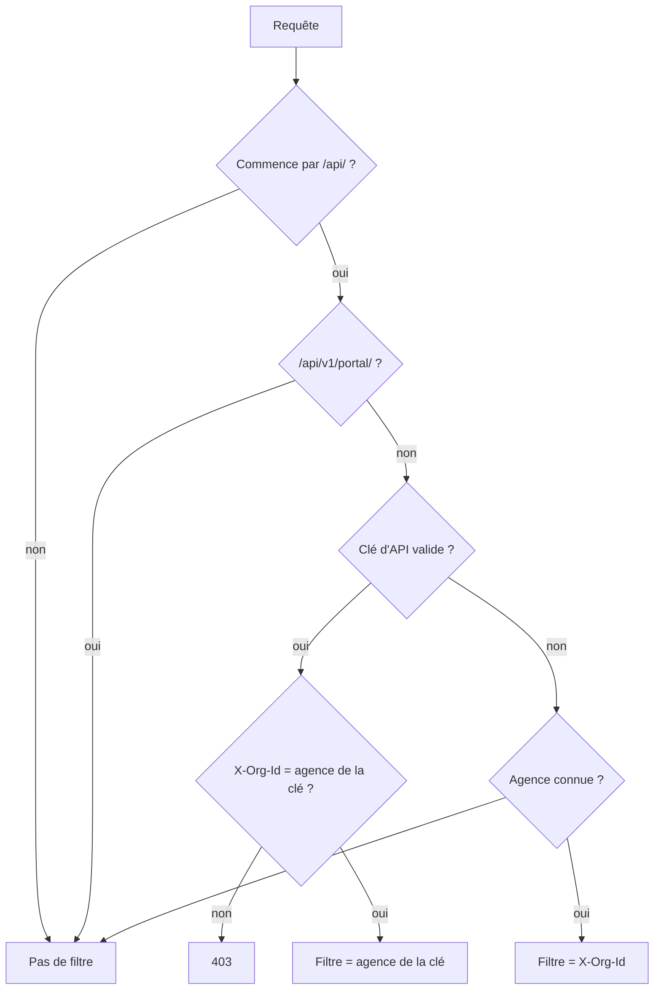

# Analyse d'Impact : isolation par agence (filtre `orgIdFilter`) et filtres de la liste des dossiers

> Périmètre : commits `3795345` → `5eeb9ab` (fusionnés sur `master` en `42b1830`, 22/11/2026).
> 17 fichiers back et front, +618 / −61 lignes.

## 1. Description du changement

### 1.1 Ce qui change

| # | Changement | Commit |
|---|------------|--------|
| C1 | Le filtre Hibernate `orgIdFilter` s'applique enfin à la session de la requête (intercepteur placé après « open-in-view »). Avant, il tombait sur une session jetable : **aucune requête JPA n'était filtrée par agence**. | `dbe7242` |
| C2 | Le portail public `/api/v1/portal/**` est exclu du filtre (recherche inter-agences). | `5eeb9ab` |
| C3 | Sur `/api/public/v1/**`, l'agence est celle de la **clé d'API**, plus celle de l'en-tête `X-Org-Id`. Un en-tête différent de la clé est refusé (**403**). | `5eeb9ab` |
| C4 | Les modèles partagés (`org_id = 'SYSTEM'`) de `WorkflowDefinition` et `WorkflowTemplateEntity` restent visibles de toutes les agences. | `5eeb9ab` |
| C5 | Liste des dossiers : recherche serveur `q` (nom ou téléphone), filtre `leadSource` (contient, insensible à la casse), filtre annonce, puces de filtres actifs. | `3795345`, `5eeb9ab` |
| C6 | Liste des dossiers côté front : seule la dernière requête s'affiche, saisie de source annulable, puce affichée sur les liens `?source=`, recherche serveur des annonces. | `5eeb9ab` |
| C7 | Bouton du menu : libellé et icône suivent l'état réel (tiroir mobile ou barre latérale). | `7054b1a`, `5eeb9ab` |

### 1.2 Pourquoi

- **Sécurité** : la liste des dossiers montrait ceux des autres agences (fuite inter-agences).
- **Régressions trouvées en revue** après C1 : portail réduit à l'agence du visiteur, modèles système invisibles, clé d'API contournable par l'en-tête.
- **Usage** : les agents ne pouvaient ni rechercher côté serveur ni filtrer par source ou par annonce.

### 1.3 Règles métier introduites ou précisées

- **BR-001 Isolation par agence** : une requête authentifiée sur `/api/**` ne lit que les lignes de l'agence de la requête (`org_id`).
- **BR-002 Agence d'une clé d'API** : sur `/api/public/v1/**`, l'agence est celle de la clé. Un `X-Org-Id` différent est refusé (403).
- **BR-003 Portail inter-agences** : `/api/v1/portal/**` n'est pas filtré par agence.
- **BR-004 Modèles partagés** : les lignes `org_id = 'SYSTEM'` des modèles de workflow sont lisibles par toutes les agences, sans y être modifiables par une agence.
- **BR-005 Recherche dossiers** : `q` cherche dans le nom (insensible à la casse) ou le téléphone. `leadSource` filtre en « contient », insensible à la casse. `%` et `_` sont cherchés comme des caractères ordinaires.

### 1.4 Matrice de décision : quel filtre d'agence ?

| Chemin | Clé d'API valide | `X-Org-Id` | Résultat |
|--------|------------------|------------|----------|
| Hors `/api/` | — | — | Aucun filtre |
| `/api/v1/portal/**` | — | quelconque | Aucun filtre (BR-003) |
| `/api/v1/webhooks/**`, `/api/v1/public/consent/**` | — | absent | Aucun filtre, la route résout l'agence elle-même |
| `/api/public/v1/**` | oui | = agence de la clé | Filtre sur l'agence de la clé |
| `/api/public/v1/**` | oui | ≠ agence de la clé | **403** |
| `/api/**` (autres) | — | absent | **400** (TenantFilter, inchangé) |
| `/api/**` (autres) | — | présent | Filtre sur `X-Org-Id` |

## 2. Zones impactées

### 2.1 Code / Composants

| Composant | Impact | Sévérité | Détails |
|-----------|--------|----------|---------|
| `HibernateFilterInterceptor` | Modification | **Haute** | Active le filtre pour de vrai (C1), avec les exclusions C2 et C3. Touche **les 64 entités** annotées `@Filter(name = "orgIdFilter")`. |
| `WebConfig` | Modification | Haute | Ordre de l'intercepteur : `LOWEST_PRECEDENCE`, après open-in-view. |
| `WorkflowDefinition`, `WorkflowTemplateEntity` | Modification | Moyenne | Condition `(org_id = :orgId OR org_id = 'SYSTEM')`. |
| `DossierService.list(...)`, `DossierController` | Ajout | Moyenne | Paramètres `leadSource` et `q`, échappement LIKE. |
| `PortalPublicController` | Comportement | Moyenne | Redevient inter-agences grâce à C2 (code inchangé). |
| `PublicApiV1Controller` | Comportement | **Haute** | Agence forcée par la clé (C3). |
| `TenantProvisioningService` | Aucun constaté | Basse | Change d'agence en cours de requête, mais n'y fait que des écritures (`saveAll`), que le filtre n'affecte pas. `OrganizationSettings`, `WhiteLabelConfigEntity` et `TenantProvisioningEntity` ne portent pas le filtre. Voir R3. |
| `AutoQualificationService`, `PitchReplyService`, `ReverseMatchingService`, `EmailDigestService`, `AppointmentReminderScheduler`, `OutboundJobWorker`, `PitchFollowUpService` | À vérifier | Moyenne | Changent aussi d'agence. Sans risque s'ils tournent hors requête HTTP (planificateur, webhook) ; problème du même type que R3 s'ils sont appelés pendant une requête `/api/` authentifiée. |
| `MessageService` (l. 124) | Aucun | Basse | Active déjà le filtre lui-même : redondant mais cohérent. |
| `dossiers.component.ts/.html` | Modification | Moyenne | Flux de rechargement unique (`switchMap`), annulation de la source, recherche d'annonces. |
| `app-layout.component.ts/.html` | Modification | Basse | Signal `menuExpanded`. |

### 2.2 Base de données

| Table | Impact | Migration nécessaire | Détails |
|-------|--------|---------------------|---------|
| Les 64 tables multi-agences | Toutes les lectures JPA ajoutent `org_id = ?` | Non | Les index sur `org_id` deviennent critiques. `DatabaseIndexAudit` signale déjà l'absence de `idx_dossier_org_id_status` et `idx_outbound_message_org_id_status`. |
| `dossier` | Nouveau `LIKE` sur `lower(lead_name)`, `lead_phone`, `lower(lead_source)` | Non (recommandée en PostgreSQL) | Recherche « contient » : pas d'index B-tree utilisable. Au-delà de quelques milliers de dossiers par agence, prévoir un index `pg_trgm` dans `migration-postgres/`. |
| `workflow_definition`, `workflow_template` | Lignes `SYSTEM` lisibles de toutes les agences | Non | — |

### 2.3 APIs

| Endpoint | Impact | Breaking change ? | Détails |
|----------|--------|-------------------|---------|
| Toutes les routes `/api/**` authentifiées | Ne renvoient plus les données des autres agences | **Oui (voulu)** | Un client qui lisait d'autres agences, volontairement ou par erreur d'en-tête, ne voit plus que la sienne. |
| `/api/public/v1/**` (syndication Mubawab/Avito, dossiers) | 403 si `X-Org-Id` ≠ agence de la clé | **Oui** | Les intégrateurs qui envoient un `X-Org-Id` fixe ou fictif sont bloqués. Voir R1. |
| `GET /api/v1/dossiers` | Ajout de `q` et `leadSource` | Non | Paramètres optionnels. `leadSource` était ignoré, il filtre désormais. |
| `GET /api/v1/portal/annonces` | Redevient inter-agences | Non | Retour au comportement d'origine. |
| `GET /api/v1/workflow/templates`, `GET /api/document-workflows/templates` | Modèles système visibles | Non | Retour au comportement d'origine. |

### 2.4 Interface utilisateur

| Écran / Composant | Impact | Détails |
|-------------------|--------|---------|
| Liste des dossiers | Fonctionnel | Recherche serveur (300 ms), panneau Filtres (annonce, source), puces retirables, lien `?source=` avec puce. |
| Tableau de bord Rapports → Dossiers | Fonctionnel | `drillDownToSource()` filtre réellement par source, avec une puce visible. |
| Portail public | Correctif | Toutes les agences visibles, même pour un navigateur où un agent est connecté. |
| Bibliothèque de workflows | Correctif | Modèles système de nouveau listés. |
| Barre supérieure (mobile) | Accessibilité | `aria-label` correct (« Replier » / « Déplier »). |

### 2.5 Processus métier

| Processus | Impact | Utilisateurs affectés |
|-----------|--------|----------------------|
| Gestion des prospects | Les agents ne voient que leurs dossiers, et peuvent chercher et filtrer | Tous les agents |
| Création d'agence (provisioning) | Aucun constaté, voir R3 | Super-admins |
| Diffusion vers les portails (syndication) | Flux bloqués si l'en-tête est faux, voir R1 | Agences avec flux Mubawab/Avito |
| Instanciation de workflows depuis un modèle | Rétablie | Admins d'agence |

### 2.6 Intégrations externes

| Système | Impact | Communication nécessaire |
|---------|--------|--------------------------|
| Intégrateurs API publique (clé d'API) | `X-Org-Id` doit être égal à l'agence de la clé | **Oui, avant mise en production** |
| Mubawab / Avito (flux XML) | Idem, si l'appel passe par `/api/public/v1/syndication/*` | Oui |
| Keycloak | Aucun | Non |

### 2.7 Documentation

| Document | Écart |
|----------|-------|
| `03_technique/15_api_public_portal_biz.md` | Affirme « pas de `X-Org-Id` requis » pour `/api/public/v1`, alors que `TenantFilter` le rend obligatoire (400 sinon). L'écart existait avant ce changement. Avec C3, la règle devient « **obligatoire et égal à l'agence de la clé** ». À corriger, ou à rendre l'en-tête facultatif sur ce chemin (voir § 5). |

## 3. Risques

| ID | Risque | Probabilité | Impact | Mitigation |
|----|--------|-------------|--------|------------|
| R1 | Intégrateurs ou flux de syndication bloqués en 403 à cause d'un `X-Org-Id` erroné | Moyenne | Haute | Vérifier les journaux d'accès `/api/public/v1` avant de déployer (en-tête comparé à l'agence de la clé). Prévenir les intégrateurs. Option : dispenser ce chemin d'`X-Org-Id` dans `TenantFilter`, puisque la clé suffit. |
| R2 | Écran ou rapport qui dépendait, sans le savoir, d'une lecture inter-agences (comme le portail) | Moyenne | Moyenne | Recette sur les écrans d'admin et de rapports. Rechercher les `TenantContext.setOrgId` appelés pendant une requête. |
| R3 | Une future lecture d'une entité filtrée dans `TenantProvisioningService` (aujourd'hui : écritures seulement) renverrait des données de l'agence de l'admin, pas de l'agence créée | Basse | Moyenne | Commentaire dans le service. Toute lecture ajoutée après `TenantContext.setOrgId` doit relier le filtre à l'agence cible. |
| R4 | Un utilisateur connecté peut viser une autre agence via `X-Org-Id` | Moyenne | **Haute (sécurité)** | **Partiellement traité** (branche `fix/jwt-org-check`) : si le jeton porte `org_id` et qu'il diffère de l'en-tête, la requête est refusée (403), sauf pour un SUPER_ADMIN. Mapper Keycloak ajouté (`infra/keycloak/realm-export.json`, attribut `orgId` → claim `org_id`, modifiable par les admins seulement) et front aligné sur la claim. **Reste à faire** : l'import du realm ne s'applique qu'à un realm neuf ; sur le Keycloak de production, créer le mapper, régler la politique d'attributs et renseigner `orgId` sur les comptes existants à la main. |
| R5 | Performance : filtre `org_id` sur toutes les requêtes et `LIKE '%…%'` sur `dossier` | Basse à moyenne | Moyenne | Index composites signalés par `DatabaseIndexAudit`, `pg_trgm` si besoin. Surveiller la latence p95 sous Grafana. |
| R6 | Modèles `SYSTEM` modifiables par une agence (filtre élargi en lecture) | Basse | Moyenne | Vérifier que la mise à jour et la suppression des modèles refusent `org_id = 'SYSTEM'` côté service. |
| R7 | Profil PostgreSQL non exécuté sur ce changement (seul H2 l'a été) | Moyenne | Moyenne | `mvn verify -Pbackend-e2e-postgres` avant le déploiement. |

## 4. Estimation d'effort (reste à faire)

| Tâche | Effort | Équipe |
|-------|--------|--------|
| Audit des journaux `/api/public/v1` et communication aux intégrateurs (R1) | 0,5 j | Back + produit |
| Revue des services qui changent d'agence en cours de requête (R2, R3) | 1 j | Back |
| Contrôle `X-Org-Id` / claim JWT (R4) | 1,5 j | Back + QA |
| Index PostgreSQL (R5), migration `V149+` | 0,5 j | Back |
| Corriger `15_api_public_portal_biz.md` | 0,25 j | Back |
| Recette PostgreSQL et écrans (R2, R7) | 1 j | QA |
| **Total** | **≈ 4,75 jours** | |

## 5. Plan de migration

1. **Avant** : exécuter `mvn verify -Pbackend-e2e-h2` et `mvn verify -Pbackend-e2e-postgres`. Analyser les journaux de `/api/public/v1` (R1) et prévenir les intégrateurs concernés.
2. **Décision R1** : soit garder le 403 (plus strict), soit dispenser `/api/public/v1/**` d'`X-Org-Id` dans `TenantFilter`, la clé suffisant. La seconde option supprime le risque de blocage et aligne le code sur la doc publique.
3. **Revue R2** : relire les services qui changent d'agence en cours de requête.
4. **Déploiement** : aucune migration de base requise. Déploiement back et front classique.
5. **Surveillance (48 h)** : taux de 403 et 404 par route, latence p95 de `GET /api/v1/dossiers`, erreurs du provisioning.
6. **Retour arrière** : revenir à `2d7b187` (avant `5eeb9ab`) annule C2 à C7 et ramène les régressions du portail et des modèles. Revenir avant `dbe7242` rouvre la **fuite inter-agences** : à éviter, préférer un correctif ciblé.

## 6. Communication

| Audience | Message | Canal | Date |
|----------|---------|-------|------|
| Intégrateurs API publique | `X-Org-Id` doit être égal à l'agence de la clé, sinon 403 (ou : en-tête désormais facultatif, selon la décision R1) | E-mail et doc API | Avant le déploiement |
| Agents | Nouvelle recherche et nouveaux filtres de la liste des dossiers ; seuls les dossiers de leur agence sont visibles | Note de version | Au déploiement |
| Équipe technique | Le filtre `orgIdFilter` est désormais effectif : tout code qui change d'agence pendant une requête doit gérer le filtre | README back / ADR | Au déploiement |

## 7. Glossaire

| Terme | Définition |
|-------|------------|
| Agence (org) | Locataire du CRM. Identifiée par `org_id` sur chaque ligne. |
| `orgIdFilter` | Filtre Hibernate qui ajoute `org_id = :orgId` aux lectures JPA de la session. |
| Open-in-view | Session JPA ouverte pendant toute la requête HTTP. Le filtre doit y être activé. |
| `SYSTEM` | Pseudo-agence qui porte les modèles partagés. |
| Clé d'API | Secret d'un intégrateur, rattaché à une agence (`ApiKeyEntity.orgId`). |
| Portail | Vitrine publique des annonces de toutes les agences (`/api/v1/portal`). |
